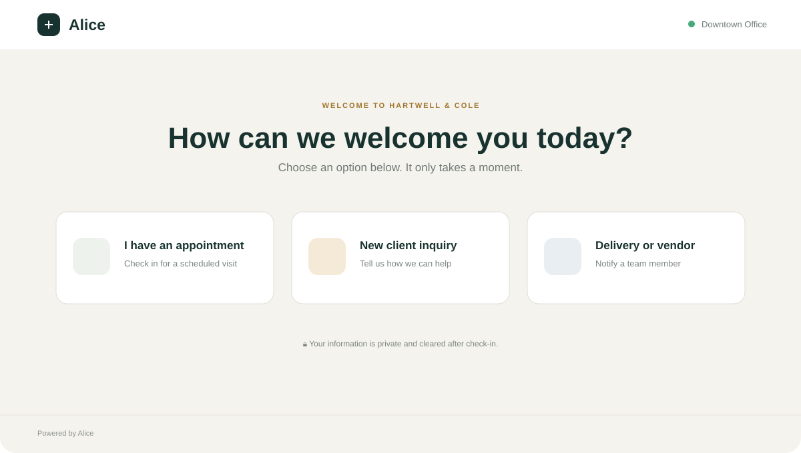

# Alice Kiosk

Alice is a multi-location lobby check-in MVP for law firms, dental groups, and other professional-services organizations. It is built from scratch around an **Organization → Location → Kiosk** hierarchy rather than retrofitting a single-office visitor log.

**[Open the live interactive demo](https://antispam2tor.github.io/alice-kiosk/)** · Pairing code: **482 731**



## What is included

- Six-digit, single-use device pairing and signed device sessions
- Appointment, new-client/walk-in, and delivery/vendor check-in paths
- Privacy timeout that clears visitor information automatically
- Touch-friendly kiosk interface for iPad, Android, and Windows kiosk mode
- Multi-location operations dashboard and live lobby view
- PostgreSQL schema with tenant row-level security policies
- Versioned form, webhook subscription, and integration-ready data models
- CRM and notification adapter contracts (`findAppointment`, `markArrived`, `createLead`, `uploadSignedForm`)
- Seeded zero-setup demo and Docker/PostgreSQL production-shaped mode

## Run the demo

Requires Node.js 22 or newer.

```bash
npm install
npm run dev
```

Open [http://localhost:5173](http://localhost:5173) and use pairing code **482 731**. The admin demo is at [http://localhost:5173/admin](http://localhost:5173/admin).

The in-memory demo intentionally contains no real client data and resets when the API restarts.

The GitHub Pages build is also a browser-only demonstration. It never sends visitor details to a server and must not be used for real client or patient information.

## Run with PostgreSQL

```bash
docker compose up --build
```

Open [http://localhost:8787](http://localhost:8787). The seed creates the same demonstration pairing code. Activation codes are single-use in database mode.

## Architecture

```text
Tablet / touchscreen PWA
        │ signed device token
        ▼
Express API ── tenant + location context ── PostgreSQL RLS
        │
        ├── CRM adapter (Clio / Lawmatics / NexHealth / custom)
        ├── notification adapter (Teams / Slack / SMS)
        └── signed outbound events (Zapier / Make / n8n / customer webhook)
```

Each request from a paired kiosk carries a short, signed device identity. Database transactions set `app.tenant_id` and `app.location_id`; RLS adds a second isolation boundary beneath API authorization. Integration-specific logic belongs behind the contracts in `server/adapters/contracts.ts`.

## Scripts

| Command | Purpose |
| --- | --- |
| `npm run dev` | Start the web app and API with hot reload |
| `npm run build` | Type-check and build the production UI |
| `npm test` | Run the repository and tenant-boundary tests |
| `npm run typecheck` | Type-check without starting services |
| `npm start` | Serve the built UI and API |

## Production checklist

This repository is an MVP foundation, not a claim of HIPAA compliance. Before accepting real client or patient data:

1. Replace the demo admin token with OIDC/SAML, MFA, organization roles, and audited session revocation.
2. Run PostgreSQL with a non-owner application role so RLS cannot be bypassed; add RLS integration tests against the deployed database.
3. Use a managed environment with signed BAAs for every system that handles PHI. Encrypt application secrets with a KMS, not environment files.
4. Add field-level encryption and retention/deletion policies for intake details, conflict-check names, and generated documents.
5. Implement rate limiting, bot protection, immutable audit events, redacted structured logging, security monitoring, backups, and incident response.
6. Complete threat modeling, accessibility testing, dependency scanning, penetration testing, and counsel/compliance review.
7. Connect a real CRM adapter and deliver outbound webhooks through a durable queue with retries, idempotency keys, and HMAC signatures.
8. Put tablets into OS-managed single-app mode and disable screenshots, autofill, notifications, and browser navigation.

See [SECURITY.md](SECURITY.md) for the security boundary and reporting guidance.

## Deployment

The included Dockerfile is suitable for a container host such as AWS App Runner/ECS, Google Cloud Run, Render, Railway, or Fly.io. Configure `DATABASE_URL`, `JWT_SECRET`, `APP_ORIGIN`, and `ADMIN_TOKEN` as platform secrets. Run database migrations before routing traffic.

## License

Copyright © 2026 AI Simplify Solutions. All rights reserved. Add the commercial license selected by the product owner before distribution.
